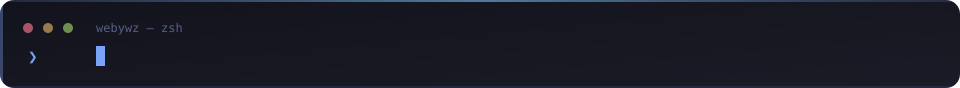
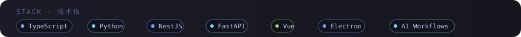
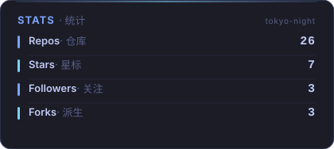
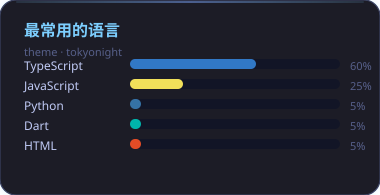

<div align="center">



**Turn contributions into something that breathes.**  
**把贡献变成会呼吸的东西。**



[](https://github.com/webywz)
[](https://github.com/webywz)



</div>


Gateways and desktop tools by day; contribution graphs that swim by night. Commits, PRs, and prompts ship as CLIs you can run. No stack parade, no badge wall — only things meant to be used.

白天写网关和桌面工具，晚上让贡献图游进水族馆。commit、PR、prompt 也做成能直接用的 CLI。不堆栈，不堆徽章——只把真正想给人用的东西放在第一屏。

## ✨ 亮点 Demo · 产品墙 / Product wall

<p align="center">
  
</p>

One outcome per cell. Copy the command and go. Each card carries a micro breathing chrome.

一格一件事。复制命令就能跑。每张卡带一点会呼吸的微光边。

<table>
<tr>
<td width="50%" valign="top">


### [contrib-aquarium](https://github.com/webywz/contrib-aquarium)

A year of commits, rendered as a living SVG aquarium. The tank below is what it paints for this profile every day.

一年的 commit 变成一座会呼吸的 SVG 水族馆。下面那座缸就是它每天给这份主页画的。

```bash
npx contrib-aquarium
```

</td>
<td width="50%" valign="top">


### [vibe-commit](https://github.com/webywz/vibe-commit)

One command for a conventional commit with taste. Messages can have character too.

一条命令，写出有品味的 conventional commit。提交信息也可以有性格。

```bash
npx @webywz/vibe-commit
```

</td>
</tr>
<tr>
<td width="50%" valign="top">


### [agent-trace](https://github.com/webywz/agent-trace)

Messy agent run logs become a readable timeline — filter, stats, Markdown & Mermaid.

杂乱的 agent 运行日志变成可读时间线：过滤、统计、Markdown / Mermaid。

```bash
npx @webywz/agent-trace
```

</td>
<td width="50%" valign="top">


### [eval-smoke](https://github.com/webywz/eval-smoke)

One-minute smoke evals for prompts and models — matchers, diffs, JUnit.

一分钟跑通 prompt / 模型冒烟评测：匹配器、diff、JUnit。

```bash
npx @webywz/eval-smoke
```

</td>
</tr>
<tr>
<td width="50%" valign="top">


### [diff-vibe](https://github.com/webywz/diff-vibe)

A git diff becomes a paste-ready PR title and body. Offline heuristic first; AI only when a key is set.

git diff 直接变成可贴的 PR title 和 body。离线启发式先出草稿，有 Key 再可选 AI。

```bash
npx @webywz/diff-vibe
```

</td>
<td width="50%" valign="top">


### [context-diet](https://github.com/webywz/context-diet)

Slim LLM context before you send it — drop noise, keep the signal, estimate tokens.

发之前先给上下文瘦身：丢掉噪声，留下信号，估算 token。

```bash
npx @webywz/context-diet
```

</td>
</tr>
</table>

## Contribution aquarium · 贡献水族箱

<p align="center">
  
</p>

Second breath layer — quieter than the hero. This tank is redrawn daily by [contrib-aquarium](https://github.com/webywz/contrib-aquarium) from my GitHub contribution calendar: commits become schools of fish, streaks grow kelp, recent activity lifts bubbles.

第二层呼吸，比 Hero 更克制。这座缸由 [contrib-aquarium](https://github.com/webywz/contrib-aquarium) 根据我的 GitHub 贡献日历每天重画：提交变成鱼群，连续打卡撑起海藻，近两周活跃则冒出气泡。

<p align="center">
  <a href="https://github.com/webywz/contrib-aquarium">
    
  </a>
</p>

## Also shipping · 更多项目

Auto-refreshed showcase cards. Hand-written copy above stays untouched.

每日自动刷新的项目卡。上面的手写文案不会被覆盖。

<!--PROJECTS:START-->
<table>
<tr>
<td width="50%" valign="top">

### [contrib-aquarium](https://github.com/webywz/contrib-aquarium)

由 GitHub 贡献图驱动的活体 SVG 水族馆，可直接嵌入 README

`SVG` · ⭐ 0 · [Demo](https://github.com/webywz/contrib-aquarium)

</td>
<td width="50%" valign="top">

### [vibe-commit](https://github.com/webywz/vibe-commit)

一条命令写出有品味的 conventional commit

`JavaScript` · ⭐ 0 · [CLI](https://github.com/webywz/vibe-commit)

</td>
</tr>
<tr>
<td width="50%" valign="top">

### [breathing-github-profile](https://github.com/webywz/breathing-github-profile)

开源的活 README 生成器：每日刷新 + 测试

`JavaScript` · ⭐ 0

</td>
<td width="50%" valign="top">

### [learn-fastapi](https://github.com/webywz/learn-fastapi)

面向前端开发者的 FastAPI 后端实战教程

`Python` · ⭐ 3

</td>
</tr>
<tr>
<td width="50%" valign="top">

### [imitate-vue-stage](https://github.com/webywz/imitate-vue-stage)

Vue 响应式原理的分阶段实现

`JavaScript` · ⭐ 2

</td>
<td width="50%" valign="top">

### [taobao-shop](https://github.com/webywz/taobao-shop)

淘宝店铺采集、后端与桌面端工具套件

`JavaScript` · ⭐ 1

</td>
</tr>
</table>
<!--PROJECTS:END-->

## About · 关于

- Put AI into real workflows, not slide decks. · 把 AI 嵌进真实工作流，而不是演示幻灯片
- Clean APIs, tools that feel good: backend, desktop, automation. · 后端、桌面端、自动化：接口要干净，工具要好用
- Care about commit messages, prompt regression risk, and details that breathe. · 在意提交信息、prompt 的回归风险，以及会呼吸的细节
- In progress: the aquarium, an offline-first CLI set; drifted prompts go to [llm-roast](https://github.com/webywz/llm-roast). · 正在打磨：水族馆、一套离线优先的 CLI；prompt 写飘了就丢给 [llm-roast](https://github.com/webywz/llm-roast)

## Stats · GitHub 统计

<!--STATS:START-->
<div align="center">

<table>
<tr>
<td>

</td>
<td>

</td>
</tr>
</table>


</div>
<!--STATS:END-->

## This profile breathes · 这个主页自己会呼吸

Driven by [breathing-github-profile](https://github.com/webywz/breathing-github-profile): marker-guarded sections refresh project cards and stats daily. The same daily-refresh job calls [contrib-aquarium](https://github.com/webywz/contrib-aquarium) to redraw `assets/aquarium.svg`. Hand-written copy outside the markers is never overwritten.

这份 README 由 [breathing-github-profile](https://github.com/webywz/breathing-github-profile) 驱动：标记保护区每天刷新项目卡和统计；同一条 daily-refresh 还会调用 [contrib-aquarium](https://github.com/webywz/contrib-aquarium) 重画 `assets/aquarium.svg`。手写的句子不会被覆盖。

<!--TIMESTAMP:START-->
*最后更新：2026-10-29 18:58:13 (Asia/Shanghai)*
<!--TIMESTAMP:END-->

---

<div align="center">


<br/>

Watch contributions swim in the [aquarium](https://github.com/webywz/contrib-aquarium). Commits with [vibe-commit](https://github.com/webywz/vibe-commit); PRs with [diff-vibe](https://github.com/webywz/diff-vibe).

有意思的话，去 [水族馆](https://github.com/webywz/contrib-aquarium) 看贡献游泳；commit 用 [vibe-commit](https://github.com/webywz/vibe-commit)，PR 用 [diff-vibe](https://github.com/webywz/diff-vibe)。

</div>
