

**Turn contributions into something that breathes.**  
**把贡献变成会呼吸的东西。**

Gateways and desktop tools by day; contribution graphs that swim by night. Commits, PRs, and prompts ship as CLIs you can run. No stack parade, no badge wall — only things meant to be used.

白天写网关和桌面工具，晚上让贡献图游进水族馆。commit、PR、prompt 也做成能直接用的 CLI。不堆栈，不堆徽章——只把真正想给人用的东西放在第一屏。

## ✨ 亮点 Demo · 产品墙 / Product wall

  

One outcome per cell. Copy the command and go. Each card is a clinical SVG tile — no blue underline chrome.

一格一件事。复制命令就能跑。每张卡是 tokyo-night clinical SVG，不再用廉价蓝下划线标题。

<table>
<tr>
<td width="50%" align="center" valign="top">

<a href="https://github.com/webywz/contrib-aquarium">
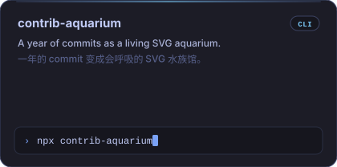
</a>

</td>
<td width="50%" align="center" valign="top">

<a href="https://github.com/webywz/vibe-commit">
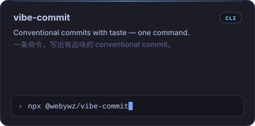
</a>

</td>
</tr>
<tr>
<td width="50%" align="center" valign="top">

<a href="https://github.com/webywz/agent-trace">
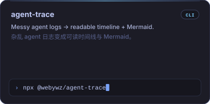
</a>

</td>
<td width="50%" align="center" valign="top">

<a href="https://github.com/webywz/eval-smoke">
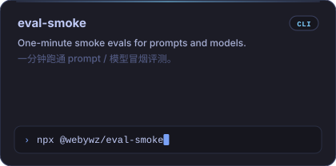
</a>

</td>
</tr>
<tr>
<td width="50%" align="center" valign="top">

<a href="https://github.com/webywz/diff-vibe">
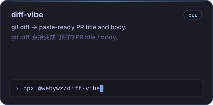
</a>

</td>
<td width="50%" align="center" valign="top">

<a href="https://github.com/webywz/context-diet">
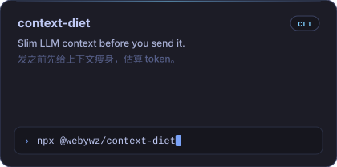
</a>

</td>
</tr>
<tr>
<td width="50%" align="center" valign="top">

<a href="https://github.com/webywz/llm-roast">
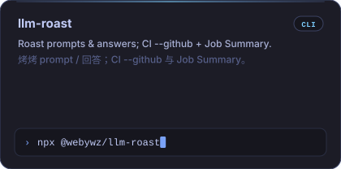
</a>

</td>
<td width="50%" align="center" valign="top">

<a href="https://github.com/webywz/prompt-diff">
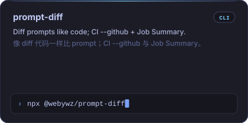
</a>

</td>
</tr>
</table>

## Contribution aquarium · 贡献水族箱

  

Second breath layer — quieter than the hero. This tank is redrawn daily by [contrib-aquarium](https://github.com/webywz/contrib-aquarium) (`@v0.1.3`) from my GitHub contribution calendar: commits become schools of fish, streaks grow kelp, recent activity lifts bubbles. Display width (`860`) is written into the SVG by the Action (`width` input); the README `` matches that size.

第二层呼吸，比 Hero 更克制。这座缸由 [contrib-aquarium](https://github.com/webywz/contrib-aquarium)（钉版 `@v0.1.3`）根据我的 GitHub 贡献日历每天重画：提交变成鱼群，连续打卡撑起海藻，近两周活跃则冒出气泡。展示宽（`860`）由 Action 的 `width` 写入 SVG，与 README 里的 `` 对齐。

  

## Also shipping · 更多项目

Auto-refreshed showcase cards. Hand-written copy above stays untouched.

每日自动刷新的项目卡。上面的手写文案不会被覆盖。

<!--PROJECTS:START-->
<table>
<tr>
<td width="50%" align="center" valign="top">

<a href="https://github.com/webywz/contrib-aquarium">
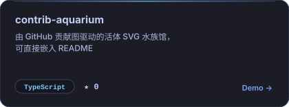
</a>

</td>
<td width="50%" align="center" valign="top">

<a href="https://github.com/webywz/vibe-commit">
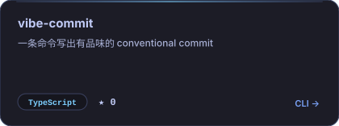
</a>

</td>
</tr>
<tr>
<td width="50%" align="center" valign="top">

<a href="https://github.com/webywz/breathing-github-profile">
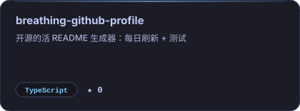
</a>

</td>
<td width="50%" align="center" valign="top">

<a href="https://github.com/webywz/learn-fastapi">
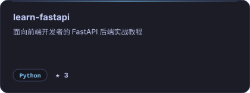
</a>

</td>
</tr>
<tr>
<td width="50%" align="center" valign="top">

<a href="https://github.com/webywz/imitate-vue-stage">
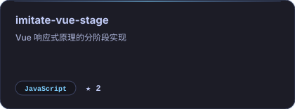
</a>

</td>
<td width="50%" align="center" valign="top">

<a href="https://github.com/webywz/taobao-shop">
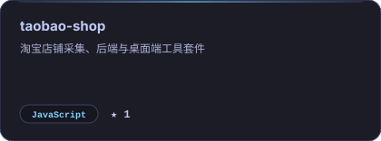
</a>

</td>
</tr>
</table>
<!--PROJECTS:END-->

## About · 关于

- Put AI into real workflows, not slide decks. · 把 AI 嵌进真实工作流，而不是演示幻灯片
- Clean APIs, tools that feel good: backend, desktop, automation. · 后端、桌面端、自动化：接口要干净，工具要好用
- Care about commit messages, prompt regression risk, and details that breathe. · 在意提交信息、prompt 的回归风险，以及会呼吸的细节
- In progress: the aquarium, an offline-first CLI set; drifted prompts go to [llm-roast](https://github.com/webywz/llm-roast). · 正在打磨：水族馆、一套离线优先的 CLI；prompt 写飘了就丢给 [llm-roast](https://github.com/webywz/llm-roast)

## Stats · GitHub 统计

<!--STATS:START-->

<table>
<tr>
<td width="50%" align="center" valign="top">

</td>
<td width="50%" align="center" valign="top">

</td>
</tr>
</table>

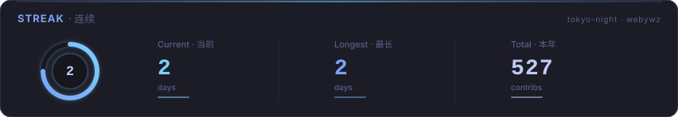

<!--STATS:END-->

## This profile breathes · 这个主页自己会呼吸

Driven by [breathing-github-profile](https://github.com/webywz/breathing-github-profile): marker-guarded sections refresh project cards and stats daily. The same daily-refresh job calls [contrib-aquarium](https://github.com/webywz/contrib-aquarium) `@v0.1.3` to redraw `assets/aquarium.svg`. Hand-written copy outside the markers is never overwritten.

这份 README 由 [breathing-github-profile](https://github.com/webywz/breathing-github-profile) 驱动：标记保护区每天刷新项目卡和统计；同一条 daily-refresh 还会调用 [contrib-aquarium](https://github.com/webywz/contrib-aquarium) `@v0.1.3` 重画 `assets/aquarium.svg`。手写的句子不会被覆盖。

<!--TIMESTAMP:START-->
*最后更新：2026-10-30 10:56:07 (Asia/Shanghai)*
<!--TIMESTAMP:END-->

---

 

Watch contributions swim in the [aquarium](https://github.com/webywz/contrib-aquarium). Commits with [vibe-commit](https://github.com/webywz/vibe-commit) (pair-workflow + CI `--github` / Job Summary); PRs with [diff-vibe](https://github.com/webywz/diff-vibe) (`--github` / Job Summary).

有意思的话，去 [水族馆](https://github.com/webywz/contrib-aquarium) 看贡献游泳；commit 用 [vibe-commit](https://github.com/webywz/vibe-commit)（pair-workflow + CI `--github` / Job Summary），PR 用 [diff-vibe](https://github.com/webywz/diff-vibe)（`--github` / Job Summary）。

